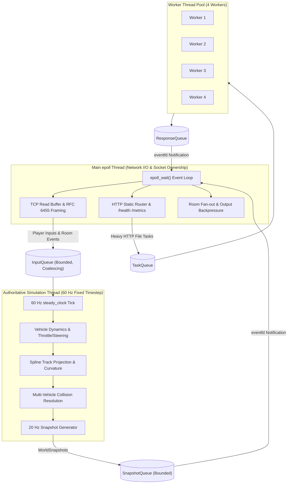
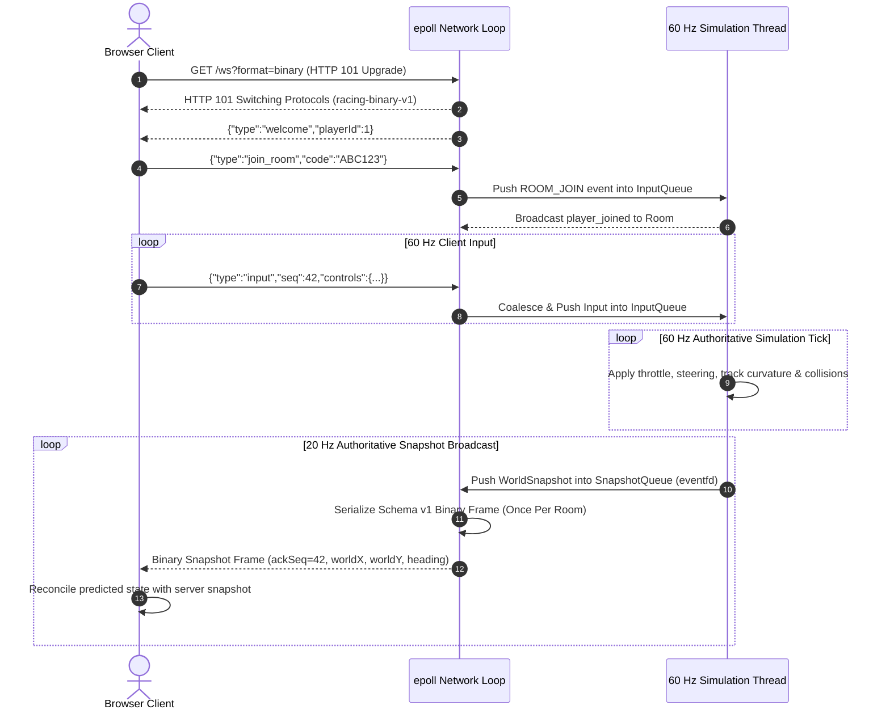

# 🏎️ High-Performance C++20 Multiplayer Racing Server

A high-concurrency, server-authoritative multiplayer browser racing game engine built from scratch in **C++20** using **Linux epoll**, **RFC 6455 WebSockets**, **server-authoritative vehicle physics**, and **low-latency binary snapshot synchronization** — zero frameworks, zero external dependencies, pure systems programming.

---

## 1. Project Overview & Features

This project implements a complete server-authoritative multiplayer racing platform capable of hosting thousands of concurrent players and game rooms with sub-millisecond simulation latency:

- **Custom epoll Web & WebSocket Server**: Non-blocking level-triggered epoll event loop managing both HTTP/1.1 static asset delivery and high-frequency RFC 6455 full-duplex WebSocket connections.
- **Dedicated 60 Hz Simulation Engine**: Server-authoritative physics loop driven by `std::chrono::steady_clock` at a fixed 60 Hz timestep ($\Delta t = 1/60\text{ s}$), running completely isolated from network socket operations.
- **20 Hz Binary Snapshot Fan-out**: Custom Schema v1 binary serializer yielding **72.6% bandwidth reduction** compared to JSON, with immutable zero-copy fan-out across room recipients.
- **Curved Catmull-Rom Spline Track Geometry**: Full server-browser math parity for curved tracks with analytical Frenet-Serret tangents, normal projection, and arc-length parameterization.
- **Authoritative Multi-Vehicle Collision Solver**: Lateral de-penetration, longitudinal momentum transfer, wall boundary clamping, and finished-vehicle immutability.
- **Client-Side Prediction & Server Reconciliation**: Sub-millisecond client responsiveness under latency, client input sequence tracking, smooth error decaying, and remote player Hermite spline interpolation.
- **Multiplayer Room & Lobby Lifecycle**: Practice mode isolation, private room codes, host ownership transfers, authoritative 5-second countdowns, and race completion leaderboards.
- **Production Observability**: Dual-format Prometheus exporter (`/metrics`, `/prometheus`) and JSON telemetry exposing 30+ atomic counters, latency histograms, and buffer depths.
- **Production Readiness & Hardening**: Strict CLI and environment variable configuration, dedicated `/health` check, out-of-tree binary execution, and multi-stage container deployment.

---

## 2. Architecture & Design Principles

### 2.1 Threading Model & Strict Socket Ownership



> [!IMPORTANT]
> **Socket Ownership Invariant**: The main epoll thread strictly owns all client sockets and output buffers (`Connection::outBuffer`). Neither simulation threads nor worker pool threads ever access socket file descriptors or perform network syscalls directly.

### 2.2 Client-Server Interaction Sequence



---

## 3. Prerequisites & Dependencies

### Prerequisites
- **Operating System**: Linux (Kernel 2.6.27+ with `epoll` and `eventfd`) or Windows via **WSL2** (Ubuntu 22.04+ / Debian 12+).
- **Compiler**: GCC 10+ or Clang 12+ with full **C++20** language support.
- **Build System**: CMake 3.10+ and Make/Ninja.
- **Tooling (Optional for Testing & Benchmarks)**: Python 3.8+, `curl`, ApacheBench (`ab`).
- **Dependencies**: **Zero external C++ libraries** (no Boost, no OpenSSL required; uses POSIX sockets and native RFC implementations).

---

## 4. Build Instructions

### Release Build (Maximum Optimization)
```bash
cmake -B build_release -DCMAKE_BUILD_TYPE=Release
cmake --build build_release -j$(nproc)
```

### Debug Build (With Debug Symbols)
```bash
cmake -B build_debug -DCMAKE_BUILD_TYPE=Debug
cmake --build build_debug -j$(nproc)
```

### Sanitizer Builds (Concurrency & Memory Safety)
The build system configures dedicated standalone sanitizer binaries:
```bash
cmake -B build
cmake --build build -j$(nproc)

# ThreadSanitizer build for data race and deadlock detection
./build/server_tsan -p 8081

# AddressSanitizer & LeakSanitizer build for memory leaks and bounds checks
./build/server_asan -p 8082
```

---

## 5. Configuration Reference

The server supports runtime configuration through CLI arguments and environment variables.

### Precedence Order
1. **CLI Flags** (Highest precedence, overrides environment variables)
2. **Environment Variables** (Overrides defaults)
3. **Hardcoded Defaults** (Fallback baseline)

| CLI Flag | Short | Environment Variable | Default | Valid Range / Options | Description |
|---|:---:|---|:---:|---|---|
| `--host` | `-h` | `HTTP_HOST` | `0.0.0.0` | Valid IPv4 string | Listen network interface |
| `--port` | `-p` | `HTTP_PORT` | `8080` | `1 – 65535` | HTTP & WebSocket listen port |
| `--static-dir` | `-s` | `HTTP_STATIC_DIR` | `./static` | Existing filesystem dir | Directory containing HTML/JS/CSS assets |
| `--threads` | `-t` | `HTTP_WORKERS` | `4` | `1 – 128` | Worker thread pool count |
| `--log-level` | `-l` | `HTTP_LOG_LEVEL` | `INFO` | `DEBUG, INFO, WARN, ERROR, NONE` | Minimum logging verbosity |
| `--help` | — | — | — | — | Print command line options and exit |

---

## 6. Running the Server

### Standalone Run
```bash
./build/server --host 0.0.0.0 --port 8080 --threads 4 --log-level INFO
```

### Out-of-Tree Execution
The binary automatically resolves static assets relative to its executable location, allowing execution from any directory:
```bash
cd /tmp
/path/to/http_server/build/server -p 8080
```

### Verification
```bash
# Verify health check
curl -i http://localhost:8080/health

# Open browser racing client
http://localhost:8080/
```

---

## 7. Docker Deployment

### Multi-Stage Container Build
The multi-stage `Dockerfile` compiles the binary in a build container and produces a hardened minimal runtime container running as non-root user `appuser`:

```bash
# Build production Docker image
docker build -t racing-server:latest .

# Run container with port forwarding and custom environment
docker run -d \
  --name racing-server \
  -p 8080:8080 \
  -e HTTP_LOG_LEVEL=INFO \
  -e HTTP_WORKERS=4 \
  --restart unless-stopped \
  racing-server:latest
```

### Container Health & Signal Verification
```bash
# Check container health status
docker inspect --format='{{json .State.Health.Status}}' racing-server

# View live container logs
docker logs -f racing-server

# Graceful shutdown (sends SIGINT)
docker stop racing-server
```

---

## 8. Reverse Proxy Configuration (Nginx)

In production, place the server behind Nginx to handle TLS termination, compression, and request routing.

A complete configuration is provided at `nginx/nginx.conf`:

```nginx
map $http_upgrade $connection_upgrade {
    default upgrade;
    ''      close;
}

upstream racing_backend {
    server 127.0.0.1:8080 max_fails=3 fail_timeout=10s;
    keepalive 32;
}

server {
    listen 80;
    server_name racing.yourdomain.com;

    # Static Assets & Health Check
    location / {
        proxy_pass http://racing_backend;
        proxy_http_version 1.1;
        proxy_set_header Host $host;
        proxy_set_header X-Real-IP $remote_addr;
        proxy_set_header X-Forwarded-For $proxy_add_x_forwarded_for;
        proxy_set_header Connection "";
    }

    # Dedicated WebSocket Upgrade Endpoint
    location /ws {
        proxy_pass http://racing_backend;
        proxy_http_version 1.1;
        proxy_set_header Upgrade $http_upgrade;
        proxy_set_header Connection $connection_upgrade;
        proxy_set_header Host $host;
        proxy_set_header X-Real-IP $remote_addr;

        # Disable buffering for real-time physics delivery
        proxy_buffering off;
        proxy_read_timeout 3600s;
        proxy_send_timeout 3600s;
    }
}
```

---

## 9. Networking & Protocol

Refer to [`docs/PROTOCOL.md`](docs/PROTOCOL.md) for complete wire frame layouts and specifications.

### Snapshot Negotiation & Wire Formats
- **Binary Snapshots (Schema v1)**:
  - 32-byte fixed header + 41 bytes per player.
  - Big-endian byte order for cross-platform IEEE 754 fidelity.
  - Zero dynamic heap allocation per recipient during broadcast.
- **Format Negotiation**:
  - Automatically negotiated via `GET /ws?format=binary` or subprotocol header `racing-binary-v1`.
  - Seamless fallback to JSON text snapshots for debugging.

---

## 10. Game Mechanics & Simulation

1. **Catmull-Rom Track Geometry**:
   - Closed-loop spline with $C^1$ continuity.
   - Pre-computed cumulative chord length parameterization.
   - Analytical Frenet-Serret framing providing orthogonal normal vectors ($T \cdot N = 0$).
2. **Vehicle Dynamics**:
   - Throttle acceleration: $a = 15.0\text{ m/s}^2$ up to max speed $45.0\text{ m/s}$ (162 km/h).
   - Natural road drag: $b = 2.5\text{ m/s}^2$ + braking deceleration $20.0\text{ m/s}^2$.
   - Lateral steering velocity: $v_x = 1.8\text{ s}^{-1}$ with track boundary clamping ($x \in [-1.0, 1.0]$).
3. **Authoritative Collision Solver**:
   - Side-by-side de-penetration along track normal $N$.
   - Longitudinal restitution and momentum transfer on rear-end collisions.
   - Finished player state immutability across finish line crossing.
4. **Client Prediction & Reconciliation**:
   - Client executes prediction loop matching server physics timestep.
   - Server snapshots carry `ackSeq` allowing instant discard of acknowledged inputs.
   - Smooth reconciliation error decay eliminating visual popping or jitter.

---

## 11. Observability, Metrics & Health Checks

### Endpoints
- **`/health`**: Returns JSON object for load balancers and container orchestrators:
  ```json
  {"status":"ok","uptime_seconds":142.312,"version":"1.0.0","port":8080}
  ```
- **`/metrics`** & **`/prometheus`**: Prometheus text format exporter:
  ```promql
  # HELP racing_simulation_tick_rate_hz Authoritative simulation loop tick rate in Hz
  # TYPE racing_simulation_tick_rate_hz gauge
  racing_simulation_tick_rate_hz 60.000000

  # HELP racing_snapshot_bytes_total Total snapshot payload bytes serialized
  # TYPE racing_snapshot_bytes_total counter
  racing_snapshot_bytes_total 3145892
  ```

---

## 12. Testing & Verification Suite

The repository contains an automated regression suite covering HTTP, WebSockets, Concurrency, Physics, Collisions, Metrics, and Sanitizers.

```bash
# Run complete automated verification suite (14 stages)
./tests/run_tests.sh
```

### Test Suite Coverage
| Suite | Script | Scope |
|---|---|---|
| **Phase 1** | `test_phase1.py` | HTTP parsing, partial writes, abrupt disconnects, 413 limits |
| **Phase 2** | `test_phase2_ws.py` | RFC 6455 framing, fragmentation, UTF-8 checks, ping/pong |
| **Phase 2.1** | `test_phase2_audit.py` | Handshake security, 64-bit frame validation, close codes |
| **Phase 3** | `test_phase3_client.py` | Static assets, MIME types, directory traversal defense |
| **Phase 4** | `test_phase4_sim.py` | 60 Hz simulation, vehicle physics, player lifecycle |
| **Phase 4.1** | `test_phase4_audit.py` | Simulation concurrency, input queue coalescing, backpressure |
| **Phase 4.2** | `test_phase4_stress.py` | Queue memory bounds, flood resistance, 40-client churn |
| **Phase 5** | `test_phase5_rooms.py` | Room creation, join/leave, host transfers, 5s countdowns |
| **Phase 5.1** | `test_phase5_audit.py` | Multi-room isolation, concurrent races, capacity limits |
| **Phase 6** | `test_phase6_track_collisions.py` | Curved track geometry, vehicle collisions, de-penetration |
| **Phase 6.1** | `test_collision_stability` | High-speed multi-body collision penetration solver |
| **Phase 6.2** | `test_phase6_2_prediction.py` | Client prediction, reconciliation, error smoothing |
| **Phase 7** | `test_phase7_metrics.py` | Prometheus scrape endpoints, atomic counters, timing |
| **Phase 7.1** | `test_phase7_1_optimization.py` | Binary snapshot wire format, format negotiation, fan-out |
| **Phase 8** | `test_phase8_production.py` | CLI flags, env vars, /health check, out-of-tree run |
| **Benchmark** | `ApacheBench (ab)` | 5,000 requests @ 50 concurrency baseline |
| **Sanitizers** | `server_tsan` / `server_asan` | ThreadSanitizer & AddressSanitizer under active load |

---

## 13. Project Structure & License

```
├── include/              # Public header definitions
├── src/                  # Component implementations
├── static/               # Browser HTML5/Canvas client
├── docs/
│   ├── PROTOCOL.md       # Complete Schema v1 protocol specification
│   └── DEVELOPMENT.md    # Architecture and contribution guidelines
├── tests/                # Automated regression test scripts
├── nginx/                # Production reverse proxy config
├── Dockerfile            # Multi-stage production container
└── CMakeLists.txt        # Build system definition
```

### License
This project is licensed under the MIT License.
